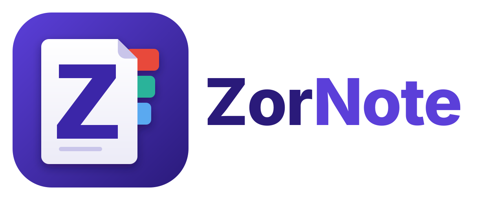

<p align="center"></p>

<p align="center"><b>OneNote-style notebooks for Linux</b><br>
Built for Zorin OS 18 · works on Ubuntu 24.04 and other distros based on it</p>

---

ZorNote organises notes the way OneNote does — **notebooks → section groups → sections → pages** — with a
OneNote-like ribbon, coloured section tabs, nested tables with shading, tags, picture resizing and PDF export.
Everything is stored locally in a SQLite database with automatic daily backups.

ZorNote is an independent, clean-room app. It is not affiliated with or endorsed by Microsoft; it does not contain
or decompile any OneNote code.

## Install

Download `ZorNote_<version>_amd64.deb` from the [latest release](../../releases/latest), then:

```bash
cd ~/Downloads
sudo apt install ./ZorNote_*_amd64.deb
zornote
```

To update, install the newer `.deb` the same way. Your notes are kept (they live outside the app, see *Your data*).

## Features

**Organising** — notebooks, section groups, coloured section tabs (drag to reorder), pages and subpages,
search across all notebooks.

**Ribbon like OneNote** — File · Home · Insert · History · View, plus a *Table* tab when the cursor is in a table.
Clipboard with Format Painter, fonts and sizes (3–72 pt), OneNote's colour palette, Heading styles.

**Tables** — type text and press Tab to start a table; tables nested inside cells; drag column borders
(touching tables resize together); shading for a cell or the whole table; *Hide Borders*; select several
tables by dragging across them and copy/paste them together.

**Tags** — To Do (Ctrl+1, click to tick), Important (Ctrl+2), Question (Ctrl+3), and *Find Tags* across all notebooks.

**Pictures** — paste or insert; click to get handles and resize like OneNote (corners keep proportions).

**Links** — Ctrl+K like OneNote: web addresses or links to any ZorNote page, section, section group or notebook; right-click ▸ *Copy Link to …*.

**Pages** — PDF export (A4, wide pages go landscape and fit), printing, Markdown/HTML export, page templates.

**Safety** — page versions (restore an older version of a page), recently deleted pages, daily backups (30 days).

**Text** — *Crisp Text* and *White text* settings for sharper small text on Linux; the Font list shows which fonts
are really installed.

## Your data

| What | Where |
|---|---|
| Notebooks (SQLite) | `~/.local/share/dev.zornote.app/zornote.db` |
| Daily backups (newest 30) | `~/.local/share/dev.zornote.app/backups/` |

*History ▸ Back Up Now* writes a backup at any time. To restore one: close ZorNote, copy the backup over
`zornote.db` (remove `zornote.db-wal` / `zornote.db-shm` if present), start ZorNote.

## Fonts (optional)

For OneNote-like text install the Microsoft core fonts and the Calibri/Cambria look-alikes:

```bash
sudo apt install ttf-mscorefonts-installer fonts-crosextra-carlito fonts-crosextra-caladea
```

## Build from source

```bash
sudo apt install -y build-essential curl wget file libwebkit2gtk-4.1-dev libxdo-dev \
  libssl-dev libayatana-appindicator3-dev librsvg2-dev libgtk-3-dev
curl --proto '=https' --tlsv1.2 -sSf https://sh.rustup.rs | sh     # Rust
# Node.js 20+ (e.g. from nodejs.org or nvm)

npm install
npm run tauri build -- --bundles deb
sudo apt install ./src-tauri/target/release/bundle/deb/ZorNote_*_amd64.deb
```

Development: `npm run tauri dev`. Tech: Tauri v2 (Rust), React, TypeScript, TipTap / ProseMirror, SQLite.

To release: bump the version in `package.json`, `src-tauri/tauri.conf.json` and `src-tauri/Cargo.toml`, push to `main` — GitHub Actions builds the `.deb` and publishes release `vX.Y.Z`.

## Changelog

See [CHANGELOG.md](CHANGELOG.md).

## Licence

[MIT](LICENSE)
